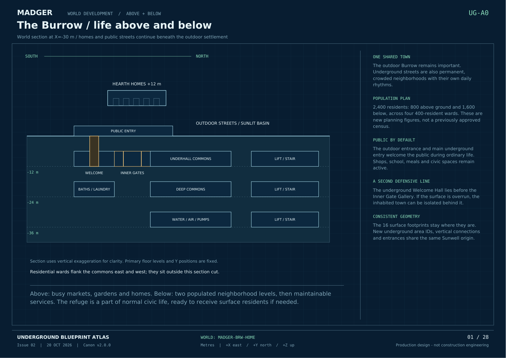

# MADGER World Bible

**Current canon: [v2.1.0 - The Living Burrow](v2.1.0/README.md)** · 20 October 2026

The Burrow is one populated town above and below ground. Outdoor markets, gardens and homes connect to permanent underground neighborhoods. Public entrances welcome ordinary daily use; a separate inner defensive boundary protects underground residents if the surface is overrun.

## Current references

- [Character and faction development](characters/README.md): 27-character register, six factions and completed Madger card; native Google Docs and PDF copies.

- [26-page Living World volume](v2.1.0/MADGER_Living_World.pdf)
- [Full present-day world text](v2.1.0/LIVING_WORLD.md)
- [Resident register](v2.1.0/Resident_Register.json) and [history workbook](v2.1.0/History_Workbook.json)
- [Underground foundation v2.0.0](v2.0.0/README.md)
- [Complete structured canon](v2.1.0/MADGER_World_Bible.json)
- [28-page underground blueprint atlas](v2.0.0/MADGER_Underground_Blueprints.pdf)
- [Connected blueprint index](blueprints/README.md)
- [Current version pointer](CURRENT.json)

## What is fixed

The original 16 surface area positions and footprints, three canal crossings, watercourse and surface route graph stay fixed. Twenty-one underground areas now share their coordinate system, with occupied levels at -12 and -24 m and services at -36 m. Each area has a measured blueprint and registered connections.

Version 2 supersedes the earlier surface-only scope, roughly 400-resident population and closed-gate default. Its new planning baseline is 800 surface and 1,600 underground residents. Population figures are authored assumptions. Public daytime access and protective closure are distinct states.

Episode 1 stays inside the Burrow, above and below, beginning with joyful ordinary life before subtle clues. Preserve all four established heroes and their approved voices. Snow White uses canine sounds only. Later owner corrections, including removal of the oversized Madger fang, supersede conflicting older brand notes.

## Growing the world

Read the current Bible before planning content. Assign new locations stable IDs, levels, footprints and measured connections. Attach scenes to recorded locations and the correct event state. Track damage, repairs, discoveries and character knowledge in a dated ledger. Preserve previous editions and record changes explicitly.

Measured exterior geography remains unassigned. The character-development extension adds eight regional concepts and writer-only antagonist plans; episode-one audience restrictions remain intact. Existing Expedition courses retain their own layouts until their world connections are defined. These archives do not claim released video or game content has already been rebuilt against the map.

## Historical references

- [v1.0.0 foundation Bible](v1.0.0/MADGER_World_Bible.pdf) and [original surface map](v1.0.0/MADGER_Burrow_Master_Map.png)
- [Surface Blueprint Atlas, Issue 01](blueprints/v1.0.0/README.md); its geometry remains current, while v2 controls access states and population.
- [Original complete editable source](v1.0.0/MADGER_World_Bible_Source.json)

Current edition sources, seven detailed sub-plans, eight resident dossiers and rebuild instructions are archived with [v2.1.0](v2.1.0/README.md). The original surface and underground atlases remain the master geometry references.

Version 2.1 develops five neighborhood identities and daily civic life. The [character-development extension](characters/README.md) now establishes Madger's founding motive, Reedbank origin, family, age and relative meeting anchors. It adds six faction concepts and a cast register. Other new biographies remain seeds; the detailed construction history, exterior maps, full companion histories and creature dossiers continue in later installments. The v2.1 archive retains its original history reservations; CURRENT.json records the additive extension and its precedence.

Character revision 1.1 expands the setting beyond the Burrow through the [Beyond the Burrow story framework](characters/v1.1.0/BEYOND_THE_BURROW.md). Existing Burrow blueprints remain current. New lore, personal reveals and their superseded reservations are recorded explicitly in the character extension.
