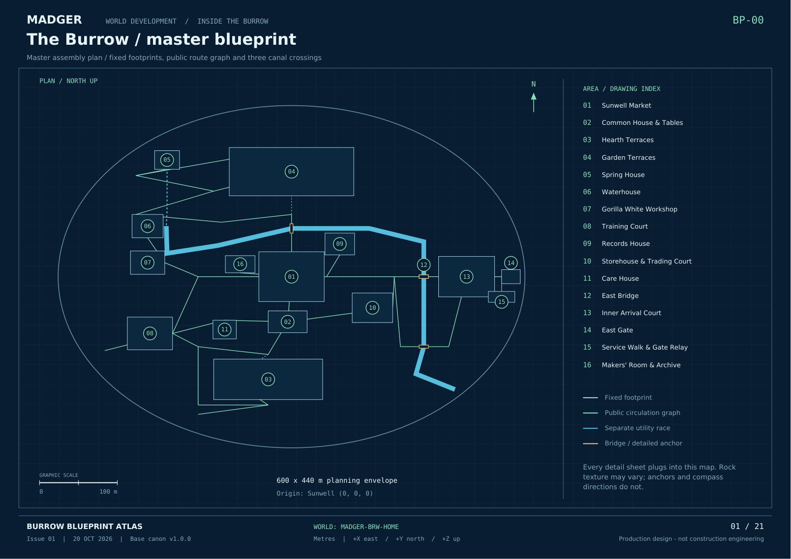

# MADGER world blueprints

**Current issue: [Burrow Blueprint Atlas v1.0.0](v1.0.0/README.md)**

The Burrow is the first district of one connected MADGER world. This atlas contains the master plan, a blueprint for each of its 16 established areas, and shared connection/system sheets.

Every new area must have its own measured blueprint and documented connections before it is used in content. Future district plans extend the existing coordinate system without silently moving or mirroring prior locations.

[Open the 21-sheet PDF](v1.0.0/MADGER_Burrow_Blueprints.pdf)

