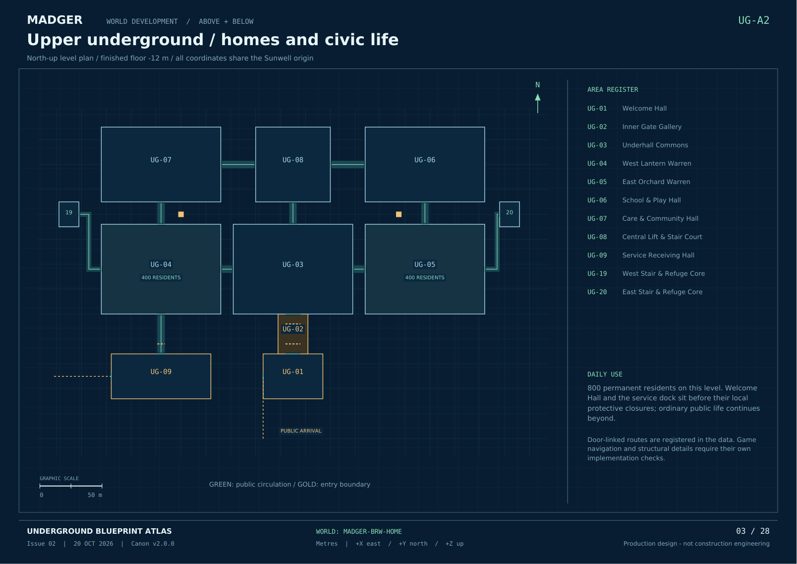

# MADGER world blueprints

**Current world canon: [v2.1.0 - The Living Burrow](../v2.1.0/README.md)**

The Burrow is the first district of one connected MADGER world. Its outdoor and underground plans share a coordinate system. Every future area needs its own measured blueprint and documented joins before use in stories, animation or the game.

| Drawing set | Contents | Open |
| --- | --- | --- |
| Living World detail, v2.1 | Seven sub-plans and Underhall index within existing allocations | [Volume](../v2.1.0/MADGER_Living_World.pdf) · [Index](../v2.1.0/README.md) |
| Underground, Issue 02 | 28 sheets: section, surface joins, three levels, defensive states, all 21 new areas and continuity | [PDF](../v2.0.0/MADGER_Underground_Blueprints.pdf) · [Index](../v2.0.0/README.md) |
| Surface, Issue 01 | 21 sheets: all 16 original areas, master plan, precinct, crossings, systems and growth | [PDF](v1.0.0/MADGER_Burrow_Blueprints.pdf) · [Index](v1.0.0/README.md) |

Surface geometry stays fixed. Version 2 overrides older closed-gate, population and underground-scope assumptions. Public daytime access and protective closure are separate states.

