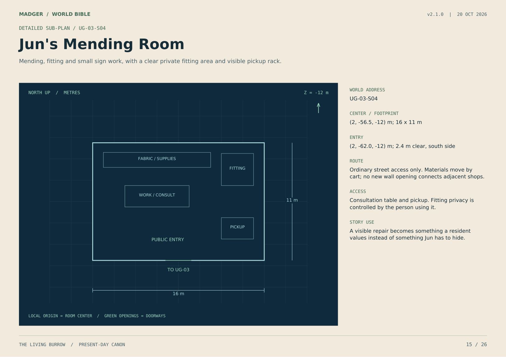
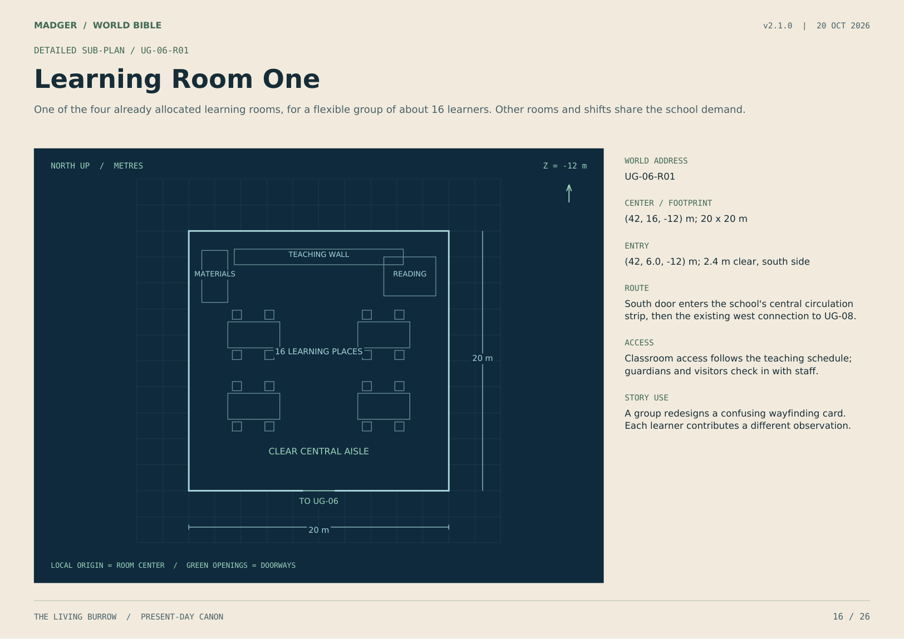
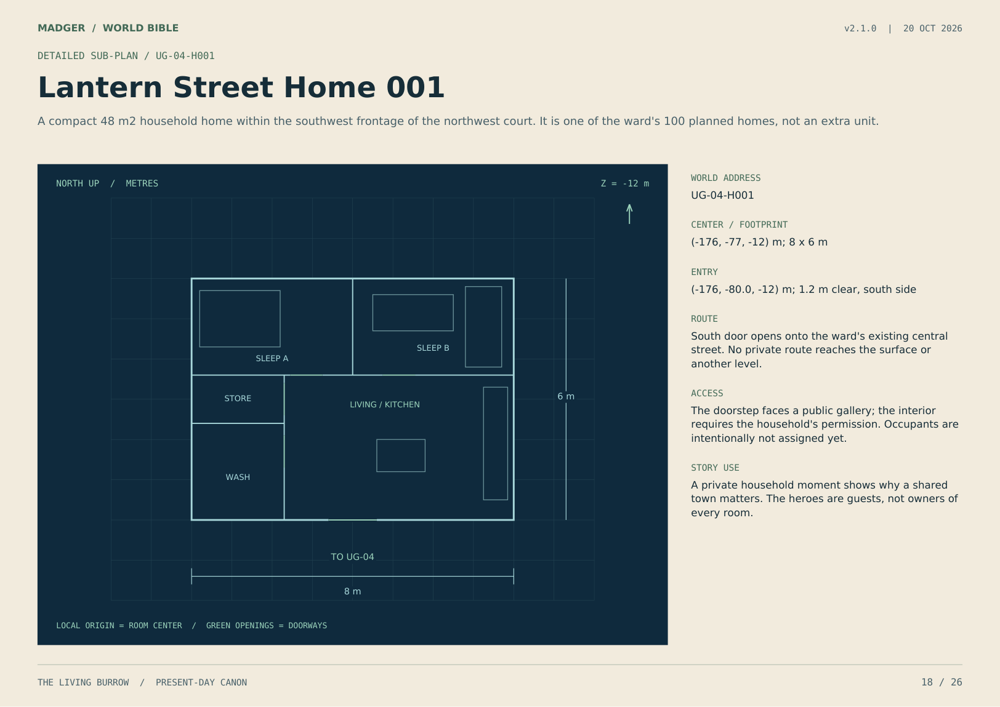

# The Living Burrow - World Bible v2.1.0

Present-day canon, 20 October 2026. History reservations are questions; story seeds are possibilities, not completed events.

## A place worth returning to

The Burrow is a shared home before it becomes the setting of an adventure.

### One town, several ways of living

Outdoor terraces hold markets, gardens and homes. Two underground levels hold permanent neighborhoods, schools, shops and shared meals. Residents move between them for work, friendship and leisure. Neither part is a lesser home.

### What this edition fixes

Every existing footprint, route, level and crossing is retained. Seven detailed sub-plans fit inside allocated spaces. Eight recurring residents, neighborhood identities and everyday institutions give those spaces a social life.

### What the owner has established

Madger created or founded the Burrow. This does not mean he rules it or built every part alone. Why he founded it, the condition of the site beforehand and who joined him remain questions for the history phase.

### Present fact, history, and possibility

Present-day entries can be used now. History reservations are questions, not hidden answers. Story seeds are possible conflicts, not events that have already happened. Concept art establishes atmosphere; measured plans control placement.

## Five neighborhoods, one community

Residents have local habits without becoming stereotypes of their address.

### Hearth Terraces / BRW-03

**Identity:** The outdoor neighborhood: laundry galleries, balcony conversations and shifting daylight. Surface homes are as permanent and socially important as the underground wards.

**Look:** Pale stone, slate, dark timber and individually colored doors; the established three tiers remain fixed.

**Sound:** Cloth moving in the breeze, footsteps on timber, distant market calls.

**Rhythm:** Early doors open toward the market; evening neighbors gather on galleries and make room for people returning from below.

**Friction:** A celebration on the gallery carries into someone else's early bedtime. Residents solve it with schedules, not blame.

**Thread:** Madger and Snow live here. Their doorway is private; being a founder does not make every hour public.

### West Lantern Warren / UG-04

**Identity:** A sociable neighborhood of doorstep exchanges, mending and shared play. Lantern means ordinary warm lighting, not a power object.

**Look:** Honey plaster, green door panels and replaceable amber electric shades; clear street crossings and low shared benches.

**Sound:** A sewing treadle, a kettle, soft games and the arrival of bread carts.

**Rhythm:** Breakfast is lively; school departures clear the common street; quiet household work follows.

**Friction:** A generous neighbor volunteers another household's time without asking. An apology changes the arrangement.

**Thread:** Mara and Jun know the value of useful work but disagree about when a favor has become an obligation.

### East Orchard Warren / UG-05

**Identity:** A neighborhood with a strong learning and gardening rhythm beside School & Play Hall. The name does not create an underground orchard or sunlight.

**Look:** Garden green, chalk blue, labeled plant starts under grow lights and picture-and-number door signs.

**Sound:** Practice counting, rolling school carts and watering cans returning to their rack.

**Rhythm:** Families share the morning school route; afternoons mix games, reading and plant care.

**Friction:** A confident child wants to finish a group project alone; an overlooked classmate has the useful observation.

**Thread:** Neri helps students investigate familiar places without turning every walk into a lesson.

### West Deep Warren / UG-10

**Identity:** A quiet neighborhood with many shift workers, apprentices and makers. Residents work throughout the Burrow; this is not a compulsory worker district.

**Look:** Slate-blue doors, cream surrounds, soft wall lights and felt-backed notice strips; repairable furnishings show personal care.

**Sound:** Soft shoes, low conversation and a careful knock before visiting a resting household.

**Rhythm:** Meals and rest happen at different hours. Deliveries follow marked quiet periods.

**Friction:** An apprentice wants to display a new invention while a neighbor needs sleep. They find a daytime testing place.

**Thread:** Tavi learns that making something impressive and making it dependable are different achievements.

### East Deep Warren / UG-11

**Identity:** A mixed-age neighborhood of communal suppers, small performances and storytelling, linked to Deep Commons.

**Look:** Terracotta door accents, cream walls, woven fabrics and small reversible displays made by residents.

**Sound:** Tableware, rehearsed harmonies, a story stopping when someone asks a question.

**Rhythm:** Afternoon meal preparation brings people out; performances end before the posted quiet period.

**Friction:** A familiar storyteller dislikes a younger resident correcting a detail. Evidence and kindness both matter.

**Thread:** Pell and Edda care for people in different ways: a correct record and an attentive conversation each have a place.

## The ordinary day has a shape

Time is tracked by the surface day. Underground lighting and quiet periods follow it, while essential services work in shifts.

### Before breakfast

Receiving teams count goods. Kitchen shifts prepare bread and meals. Maintenance teams compare local readings. Early deliveries stay on work routes and avoid sleeping galleries.

### Morning

Families leave homes above and below. Children and guardians travel toward UG-06; adults go to gardens, shops and workshops. Visitors enter through the public arrival sequence. Nobody must pass through a private home to reach a civic place.

### Midday

The surface market and Underhall share the busiest exchanges. Shared kitchens supplement household kitchens. Tables make room for people who are eating alone as well as established groups.

### Afternoon

Learning clubs, repairs and personal errands overlap. Service staff hand over unfinished tasks. School is not the only place children appear, and work is not the only activity adults have.

### Evening

People return to different neighborhoods, cook, rehearse, read and visit. The outdoor gate can close routinely after an announced last entry; underground inner gates stay open unless a protective state is explicitly declared.

### Night

Quiet does not mean abandoned. Limited service shifts continue, routes remain legible and home privacy matters. Night staff take rest later; daylight characters cannot appear everywhere without time passing.

## How the community makes decisions

Madger brings people together. The town also works when he is absent, tired or wrong.

### The Common Table

Residents raise matters at BRW-02 or scheduled UG-14 assemblies. Neighborhood stewards and service leads explain their part; a rotating facilitator keeps the discussion usable. Decisions and reasons are recorded where residents can inspect them.

### Ordinary rights

People can ask questions, correct a record, decline an optional activity and keep their home private. Welcome, basic care and refuge do not depend on a wallet, rank, species or personal friendship with a hero.

### Work has accountable owners

Service teams own schedules and handoffs. One named person leads a shift, but another can take over. The Records House preserves evidence and corrections; it does not silently become the government.

### Disagreement without an enemy

A grower, a teacher and a repair team can reasonably want the same cart or timeslot. Show the actual constraint, listen to affected people and record the compromise. A losing suggestion does not make its owner disloyal.

### Urgent decisions

A local lead can respond to immediate danger within an established role. Gate and service changes are logged and reviewed afterward. Urgency is temporary responsibility, not permanent power.

### The founder's place

Madger has influence through trust and action, not a private veto. His developing leadership is visible when he accepts a good objection and helps someone else carry a decision through.

## Work, exchange and finite resources

The town is prosperous because useful work is shared, maintained and recorded.

### A household economy

Residents exchange goods and paid work, share some resources and volunteer by choice. Use ordinary prices, tickets and receipts when a scene needs them. Currency names, exchange rates and any relationship to real-world MADGER products remain unassigned.

### Food takes several routes

Surface gardens and powered grow rooms supply part of the food. Trade brings grain and other staples; stores buffer interruptions. Household cooking and common kitchens coexist. The Bread Counter receives prepared batches from UG-12 rather than adding an unplanned oven shaft.

### Repair has a queue

A repair ticket records item, owner, fault, promised next update and current status. Loan tools have a return record. A delay can be honest; hiding it creates a relationship problem before it becomes a safety problem.

### Shared resources need boundaries

Communal does not mean ownerless. A household's keepsake is not quest loot. Lending a cart needs consent and a return time. Essential service stock is separate from a decorative project budget.

### Local consequences first

A missing flour crate affects named orders and a meal plan. A failed grow light affects a room and its crop schedule. State the reserve and the alternative before escalating to a town-wide crisis.

### Rest is part of capacity

Staff rotations, apprentices and handoffs are visible. Gorilla cannot lift every object, Bot cannot inspect every log and Edda cannot remain on duty forever. Ordinary neighbors keep things running.

## Culture you can see and hear

The Burrow feels like one place through recurring details, not identical buildings or identical residents.

### A repair is allowed to show

A neat seam, a replaced chair rung and a dated bridge repair can be visible. Makers receive credit. This supports pride in care without implying an ancient tradition or founding legend that has not been written.

### Courtesy at a threshold

Knock, wait and ask before entering. Leave the common street clear. Return borrowed objects to the agreed place. Visitors can learn these habits through a friendly interaction instead of a lecture.

### Meals and celebrations

Shared tables welcome newcomers; participation is optional. Bridge Reopening Day is a specific present event, not yet an annual founding festival. Small performances, games and skill exchanges need no catastrophe to justify an episode.

### Readable places

Combine area number, word and simple symbol. Color helps but is never the only direction cue. Workshop tools are labeled; school notices use pictures; light levels change gently along public routes.

### A controlled sound palette

Surface scenes carry wind, water, wheel movement and market calls. Underground scenes carry close footsteps, tableware, soft mechanical ventilation and household sounds. No constant ominous drone under a happy town.

### People and animals

This edition adds person-like animal residents without changing Snow's identity as an ordinary adult dog. Final population biology and species histories remain open. Appearance does not determine honesty, intelligence or allegiance.

## Neighbors with work of their own

Present-day roles are authored additions. Birthplaces, arrival stories, ages in years and family histories remain open.

### Mara Reed / RES-01

**Species:** rabbit

**Life stage:** adult

**Home:** UG-04

**Role:** Baker and shared-kitchen shift coordinator

**Want:** Finish the morning bake on time and keep one afternoon free for drawing.

**Strength:** Remembers preferences and plans work well.

**Flaw:** Says yes before checking whether she has the time.

**Relationship:** Jun pushes her to name the true cost of a favor; Madger recognizes his own overcommitment in her.

**Scene:** She gives a child a counted delivery task and lets the child finish it.

**Limit:** Generosity does not create unlimited free stock. She can decline an extra order without becoming selfish.

**Visual note:** Flour-marked oat apron, short green neck cloth, practical sleeves; final character model and voice remain unapproved.

**History open:** Origin, relatives, arrival date and first meeting with Madger remain unassigned.

### Tavi Moss / RES-02

**Species:** river otter

**Life stage:** older adolescent apprentice

**Home:** UG-10

**Role:** Repair apprentice and tool-loan assistant

**Want:** Earn responsibility for a complete repair, not only the easy preparation.

**Strength:** Notices how parts fit and asks direct questions.

**Flaw:** Hides small mistakes while hoping to fix them before anyone notices.

**Relationship:** Gorilla White teaches without doing every task for him; Iona asks for measurements before confidence.

**Scene:** He marks a chair as unfinished instead of allowing it onto the loan shelf.

**Limit:** Skill grows through supervised work. He cannot improvise a life-support repair or a universal gadget.

**Visual note:** Indigo work vest, rolled cuffs and a small repair notebook; model and voice are development notes.

**History open:** Family, apprenticeship start and reason for coming to the Burrow remain unassigned.

### Iona Flint / RES-03

**Species:** mole

**Life stage:** adult

**Home:** BRW-03

**Role:** Water and air maintenance lead

**Want:** Keep inspections boring enough that everyone else can enjoy the day.

**Strength:** Patient verification and excellent practical memory.

**Flaw:** Sometimes delivers a correct finding so bluntly that people stop listening.

**Relationship:** Bot helps compare records; she insists that a recorded reading and a physical reading are different things.

**Scene:** She invites a worried neighbor to see the relevant gauge and explains what it can and cannot show.

**Limit:** She is one member of a trained service team, not the sole person capable of keeping the town alive.

**Visual note:** Copper cuff marker, slate work jacket and an ordinary tool roll; no magical blindness compensation.

**History open:** Training, former home and earlier service incidents remain unassigned.

### Neri Tern / RES-04

**Species:** red panda

**Life stage:** adult

**Home:** UG-05

**Role:** Teacher and makers-club facilitator

**Want:** Help students ask better questions and leave room for their own answers.

**Strength:** Makes complicated tasks manageable.

**Flaw:** Overplans and can mistake an unexpected approach for a distraction.

**Relationship:** Snow helps children practice patient observation; Neri respects that Snow is a dog, not a speaking classroom prop.

**Scene:** She changes a lesson when a student notices that the delivery map is hard to read.

**Limit:** Children are not used as covert investigators or put in danger to prove maturity.

**Visual note:** Chalk-blue overshirt, cream satchel and pockets for reusable cards; final model and voice remain open.

**History open:** Education, birthplace and why she chose teaching here remain unassigned.

## Neighbors beyond the heroes

These residents can disagree, be funny, make errors and change without every story making them a villain or victim.

### Pell Fen / RES-05

**Species:** hedgehog

**Life stage:** adult

**Home:** UG-11

**Role:** Welcome steward and records liaison

**Want:** Make a newcomer's first day understandable.

**Strength:** Calm, fairness and careful handoffs.

**Flaw:** Clings to a procedure when the procedure itself is confusing someone.

**Relationship:** Madger encourages a personal welcome; Bot helps Pell explain rather than merely repeat a rule.

**Scene:** Pell walks a visitor to the correct counter instead of pointing at another form.

**Limit:** Public access is not a personality test. A visitor is not suspicious just because they are unfamiliar.

**Visual note:** Small green steward tab, cream waistcoat and a simple map folder; no fortress-guard uniform.

**History open:** Arrival, earlier loyalties and any founding-era role remain unassigned.

### Jun Ash / RES-06

**Species:** field mouse

**Life stage:** adult

**Home:** UG-04

**Role:** Mender, sign painter and public-notice contributor

**Want:** Make useful objects beautiful and make important information easy to find.

**Strength:** Detail, economy of material and a sharp eye for inconsistency.

**Flaw:** Treats an imperfect finished piece as a personal failure.

**Relationship:** Mara values a practical repair; Jun learns to accept visible seams instead of hiding every repair.

**Scene:** Jun adds a picture and a floor number to a sign that previously relied on color alone.

**Limit:** Small stature does not become unexplained access through pipes or vents. Route geometry still applies.

**Visual note:** Ochre apron, a measuring ribbon and ink on one cuff; species proportions require a later model sheet.

**History open:** Family craft traditions and the meaning of any personal keepsake remain unassigned.

### Edda Brook / RES-07

**Species:** beaver

**Life stage:** adult

**Home:** UG-11

**Role:** Care worker and recovery coordinator

**Want:** Give people a safe place to recover without making them feel like a burden.

**Strength:** Listening, organization and firm practical boundaries.

**Flaw:** Finds it easier to ask others to rest than to rest herself.

**Relationship:** Gorilla White cannot persuade her that endurance cancels recovery; she also accepts help from him.

**Scene:** She asks an injured neighbor whom they want informed, then records the agreed handoff.

**Limit:** Care is confidential. Treatment is not instant magic, and she does not diagnose everyone by looking at them.

**Visual note:** Cream work tunic, blue circle badge and a personal green mug; no voice or finished likeness assigned.

**History open:** Training, family and previous rescue experiences remain unassigned.

### Sori Wren / RES-08

**Species:** fox

**Life stage:** adult

**Home:** BRW-03

**Role:** Grower and produce-stall coordinator

**Want:** Get good food to tables while preserving seed and spare stock for the next cycle.

**Strength:** Practical optimism and attention to growing conditions.

**Flaw:** Hears criticism of a harvest as criticism of personal worth.

**Relationship:** Iona and Sori sometimes disagree about allocation, then compare actual supply and need.

**Scene:** Sori explains a smaller basket honestly and offers a workable substitute.

**Limit:** Species does not determine honesty. Sori is not a disguised villain or a clue to one.

**Visual note:** Garden-green apron, copper plant labels and a sun-faded hat used outdoors only.

**History open:** Former home, growing knowledge and first trade journey remain unassigned.

## Four heroes in a larger town

The existing hero arcs stay intact. Their growth appears through choices that affect other people.

### Madger / belonging without control

He starts things and makes introductions. Mara reflects his habit of saying yes to too much; Pell shows how welcome can work through an ordinary system. Progress means entrusting a meaningful task, accepting a refusal and sharing credit.

### Gorilla White / strength that teaches

The workshop is shared. Tavi needs a chance to finish a job, and Edda expects Gorilla to rest when necessary. Progress means demonstrating a skill, letting someone else try and receiving protection without shame.

### MADGER Bot / usefulness without certainty

Iona compares physical readings; Pell sees the person behind a record. Bot can preserve conflicting evidence without inventing an answer. Progress means marking uncertainty clearly and explaining the limits of his access.

### Snow White / attention that connects

Her actions are canine: sniffing, listening, pausing, looking back, returning and resting. Neri and the children learn to wait for a clear indication. Snow never translates a scent into a spoken explanation or detects a digital packet.

### Friendship has reciprocal care

A tired friend receives help. A disagreement is resolved by changed conduct, not merely a speech. The team shares ordinary meals and jokes so later separation or danger has an established emotional cost.

### Not every hero in every scene

Episodes can focus on one or two relationships while preserving the others' whereabouts. The pilot still includes all four; its brief runtime does not require introductions for all eight new residents.

## Underhall is a real address

Four named north-side shops now occupy existing bays. Their customers and deliveries share the public square; no exterior wall or main corridor moves.

## Mara's Bread Counter

A small shop with counted bread stock, a pickup counter and room to queue off the public crossing.

Center: `[-65, -56.5, -12]` m. Footprint: `[16, 11]` m. Door: `[-65, -62.0, -12]` m; 2.4 m clear.

Prepared bread arrives from UG-12 through UG-08 to UG-03; this counter has no industrial oven or new exhaust shaft.

Front of house and pickup counter. Stock and handwash nook are staff space.

A promised order competes with Mara's capacity. A correction is visible on the order slate.

## Repair & Tool Loan

A neighborhood handoff point for small repairs and loan tools. Large or hazardous work goes to BRW-07.

Center: `[-45, -56.5, -12]` m. Footprint: `[16, 11]` m. Door: `[-45, -62.0, -12]` m; 2.4 m clear.

Goods arrive through ordinary commons routes. No direct workshop tunnel is added.

Ticket counter, safe display and pickup. Bench and tool storage are supervised.

Tavi must admit a repair is not ready. An honestly delayed handoff preserves trust.

## Pantry & Produce

A measured neighborhood supply shop for fresh produce, dry staples and household containers.

Center: `[-18, -56.5, -12]` m. Footprint: `[16, 11]` m. Door: `[-18, -62.0, -12]` m; 2.4 m clear.

Supplies come from BRW-10, UG-18, surface gardens and UG-13 using recorded routes and receiving handoffs.

Display and counter. The covered stock zone is staff space.

A delivery mismatch delays one meal or job; it does not instantly starve the town.

## Jun's Mending Room

Mending, fitting and small sign work, with a clear private fitting area and visible pickup rack.

Center: `[2, -56.5, -12]` m. Footprint: `[16, 11]` m. Door: `[2, -62.0, -12]` m; 2.4 m clear.

Ordinary street access only. Materials move by cart; no new wall opening connects adjacent shops.

Consultation table and pickup. Fitting privacy is controlled by the person using it.

A visible repair becomes something a resident values instead of something Jun has to hide.

## Learning Room One

One of the four already allocated learning rooms, for a flexible group of about 16 learners. Other rooms and shifts share the school demand.

Center: `[42, 16, -12]` m. Footprint: `[20, 20]` m. Door: `[42, 6.0, -12]` m; 2.4 m clear.

South door enters the school's central circulation strip, then the existing west connection to UG-08.

Classroom access follows the teaching schedule; guardians and visitors check in with staff.

A group redesigns a confusing wayfinding card. Each learner contributes a different observation.

## Care Room One

A private assessment and recovery room within the already allocated clinic zone, with a quiet waiting position and handwash point.

Center: `[-174, 16, -12]` m. Footprint: `[12, 20]` m. Door: `[-174, 6.0, -12]` m; 2.4 m clear.

South door meets the care hall's central circulation, separate from the kitchen and food handling.

Entry by invitation or a care handoff. Personal records are not visible from the corridor.

An exhausted helper accepts rest and asks someone else to finish a job.

## Lantern Street Home 001

A compact 48 m2 household home within the southwest frontage of the northwest court. It is one of the ward's 100 planned homes, not an extra unit.

Center: `[-176, -77, -12]` m. Footprint: `[8, 6]` m. Door: `[-176, -80.0, -12]` m; 1.2 m clear.

South door opens onto the ward's existing central street. No private route reaches the surface or another level.

The doorstep faces a public gallery; the interior requires the household's permission. Occupants are intentionally not assigned yet.

A private household moment shows why a shared town matters. The heroes are guests, not owners of every room.

## Safety is a condition, not a color

A place can be welcoming, private, supervised or temporarily unsafe. Keep access rules separate from threat level.

### Everyday civic spaces

Markets, commons, school routes, clinic waiting areas and the assembly hall are maintained safe in the peaceful baseline. Minor friction is social or practical; the background does not randomly attack residents.

### Private spaces

Homes and personal records are private, not dangerous. A closed bedroom door is a boundary, not automatic evidence of a secret. Ask who has permission and why.

### Working spaces

A running wheel, hot kitchen, tool bench, wet floor or service plant can present an ordinary local hazard. Supervision and a clear work boundary make the risk understandable without making the whole district sinister.

### Temporary restricted areas

Inspection, repair, smoke or a blocked route can change one location's status. Record start, reason, affected paths, alternate route and conditions for reopening. Restore or preserve damage explicitly.

### Surface overrun

The welcome sequence, inner closures, service boundary and stair thresholds keep their v2 roles. The town's response is protection of people and lifelines. No extra escape tunnel appears simply because a scene needs one.

### Dangerous regions come later

No named wilderness, monster territory, hostile settlement or attacker base is established here. Those places will need their own geography, ecology, history, inhabitants and connection to the Burrow before use.

## Lifelines and trust

Separate physical events, digital records and what characters believe happened.

### Water and air

Iona's team checks local conditions; records help compare them. Drinking water stays separate from the canal. Underground waste is pumped up to the established service connection. Doors do not make air, pumps or staff unnecessary.

### Power and food

Local supplies and backups have limited capacity. The wheel, roofs and batteries are not one omnipotent core. Grow rooms need power. Food reserves require quantities and elapsed time before a shortage becomes a plot fact.

### A receipt is a claim

D17 remains a delivery identifier. A duplicate could reflect error, replay, fraud or another cause not yet established. The pilot does not decide which. Bot preserves source, time and uncertainty rather than accusing a visitor.

### Physical controls remain physical

A forged status cannot move a manual gate bar. A later antagonist must have a documented route, ability, access and limit. Do not replace a mystery with a universal hacking power.

### Private information has purpose

A service reading, a delivery record and a care record have different viewers. Residents can request corrections. No omniscient surveillance wall is added to simplify exposition.

### Repair creates history

When a later event changes a sign, door, service setting or relationship, record its before and after. The next episode inherits that result instead of resetting the town for convenience.

## Many kinds of episode can live here

These are story seeds, not completed events or locked episode orders.

### Community comedy / a favor too many

Mara promises more orders than one shift can finish. Madger's attempt to help creates a second commitment. A truthful renegotiation lets others plan; the cost is awkwardness and work, not a surprise villain.

### Craft / the unfinished chair

Tavi wants a visible success. A repair looks finished but still fails an ordinary check. He must label it honestly and ask for help before a neighbor uses it.

### Learning / the map that misleads

Neri's group tests a wayfinding card. Jun discovers it depends on color and an adult's reading height. A clearer sign helps visitors and changes Neri's planned lesson.

### Friendship / the empty place at supper

Gorilla misses a shared meal because everyone assumes he can finish one more job. The others must notice the habit, not just deliver a plate. He must also name his own limit.

### Mystery / two records, one crate

A delivery count disagrees with a stored receipt. Bot and Pell separate what is known from what is guessed. A local discrepancy supports investigation without deciding the season villain in advance.

### Weather, care and defense later

A seasonal disruption can require a route change; a recovery story can test patience; an eventual defense story can test welcome under pressure. Each uses known places, bounded abilities and lasting consequences.

## The pilot still begins with joy

The audience should care about ordinary life before it notices the first discrepancy.

### 00:00-00:50 / home, street, sunlight

Begin in an underground household and Underhall. Follow ordinary movement up to the surface. All four heroes contribute through brief useful actions. Do not open on alarms, fortifications or a lore monologue.

### 00:50-01:40 / a welcome

A visitor and delivery show public access. Inner gates stand open. One duplicate D17 receipt is quietly preserved. Use inward framing at the outdoor threshold so exterior geography stays unassigned.

### 01:40-03:00 / shared accomplishment

Neighbors reopen the weather-repaired bridge. Gorilla accepts help; Madger shares credit. The bridge remains sound. Allow real route changes and time cuts between locations.

### 03:00-04:10 / life continues

Learning, food and a small personal exchange keep the town alive. After a time cut, Snow holds an indication at the intact gate relay. This is a physical trace with no known cause.

### 04:10-05:00 / homeward, then a question

Friends and households return home. Establish routine evening gate closing before the final unexplained acknowledgment. No one has passed. End with a small contradiction, not an attacker reveal.

### What the new cast contributes

One or two recurring residents may have readable supporting actions; others remain background or offscreen. Avoid using five minutes to explain eight biographies. Their deeper stories belong in later episodes.

## Build history from evidence and choices

The present world is now detailed enough to ask specific historical questions without filling the answers prematurely.

### Madger and the founding

Owner-established fact: Madger created the Burrow. Still open: what he wanted to protect or provide, what existed at the site, the first commitment he made, who disagreed, what he sacrificed and how shared responsibility grew.

### The four companions

For each pair: where they first met, what each wanted, the initial misunderstanding, the action that earned trust and the unresolved difference that survives today. Establish order and elapsed time before writing flashbacks.

### The residents' origins

Track former home, reason for leaving or staying, skills brought, people left behind, arrival route and present sense of belonging. Not every resident must be a refugee or share one founding trauma.

### Every place has a material history

For each area: prior condition, builder or community, purpose at creation, source of materials, later alterations and surviving evidence. Do not date a door, trophy or inscription until its event is recorded.

### What is true versus remembered

Maintain objective event, eyewitness accounts, rumor and character belief separately. A mistaken memory can be dramatic; it must not silently alter the factual ledger.

### Chronology before flashbacks

Use relative sequence IDs until calendar and character ages are fixed. Give an event prerequisites, location, participants, result and who knows. Then connect it to the already established present.

## Make future threats belong to this world

Villains, monsters and hostile animals will be developed in the history and wider-world phase, with reasons, limits and consequences.

### An antagonist is more than an attack

Reserve fields for desire, belief, grievance, chosen methods, resources, limits, relationships and a line they will or will not cross. Explain what they want from the Burrow and why they cannot simply take it.

### Species is not allegiance

An evil animal can be an individual who makes cruel choices. A dangerous predator can act through hunger or territory. Keep moral choice, ecological danger and any later supernatural influence distinct.

### A creature belongs somewhere

Define habitat, food, movement, senses, reproduction if relevant, signs of presence and interaction with other life. Establish what residents know before an encounter. Powers need visible limits and costs.

### Safe and dangerous are contextual

A home refuge can be safe for residents; a nesting area can be dangerous to an intruder without being evil. Map boundaries and routes. A monster does not appear in a neighborhood merely because an action scene is due.

### Mystery is not a premature answer

No villain identity, monster species, magical system or exterior map is fixed by this edition. The D17 record and Snow's trace remain unresolved; neither is retroactively declared proof of a creature or faction.

### Reveal in stages

A later story may progress from observation to competing explanations, a verified local effect, a responsible actor and wider stakes. Each revelation must explain prior evidence and leave the characters with a meaningful choice.

## A world that can carry seasons

A season should change relationships and knowledge while preserving a recognizable home.

### Choose one central question

Examples for future development: Can a welcoming community protect itself without losing trust? When does helping become control? What does belonging require from a founder and from a newcomer? These are possibilities, not a locked season plan.

### Give each episode a complete local story

A person wants something in a specific place. A real constraint forces a choice. That choice has a visible cost or benefit. The episode resolves its local question while leaving a consequence another story can use.

### Track parallel arcs

For each hero record present belief, test, choice, changed behavior and relationship effect. Use small differences across episodes. A speech without a changed action is not an earned arc.

### Limit exposition

Let recurring signs, places and habits carry familiarity. Introduce an origin detail only when it affects a current decision. A history volume can be extensive while an episode reveals only what that moment needs.

### Separate story and game states

Player upgrades, collectibles and retries do not become historical facts automatically. The same place keeps its coordinates. An anime background and a game room agree on doors, travel connections and permanent objects.

### Before a scene is approved

Check location and access state, time and travel, who knows what, resources and injuries, approved likenesses and voices, physical limits, and the event ledger. Snow remains canine. Madger keeps normal teeth and a clean face.

## What is now ready to use

This is an additive present-day expansion. It does not move the Burrow or silently write its past.

### Seven detailed spaces

UG-03-S01 Bread Counter; S02 Repair & Tool Loan; S03 Pantry & Produce; S04 Mending Room; UG-06-R01 Learning Room One; UG-07-R01 Care Room One; UG-04-H001 Lantern Street Home 001. Every footprint stays inside its existing parent allocation.

### Five neighborhoods and eight neighbors

The original surface neighborhood and four underground wards now have distinct daily identities. Eight resident dossiers record present roles, desires, strengths, flaws and relationships, with historical fields intentionally open.

### What stays unchanged

All 37 primary area positions and footprints, the surface and underground route graphs, three canal crossings, four approved hero profiles and voice references, 2,400-resident planning baseline, public access and independent inner defense.

### What remains to develop

The other household interiors, complete occupancy census, final civilian model sheets and voices, detailed founding chronology, companion meetings, migrations, factions, named villains, monsters and exterior regions.

### Source of authority

Latest owner instructions come first. Current canon and measured plans control the world; event records control changes. This volume adds present-day detail and records future questions. The atmosphere painting is not a measured camera plate.

### Use across media

The edition supplies stable addresses and relationships for comics, videos, episodes, seasons and game scenes. It is world development material; it does not claim those media have already been produced.

